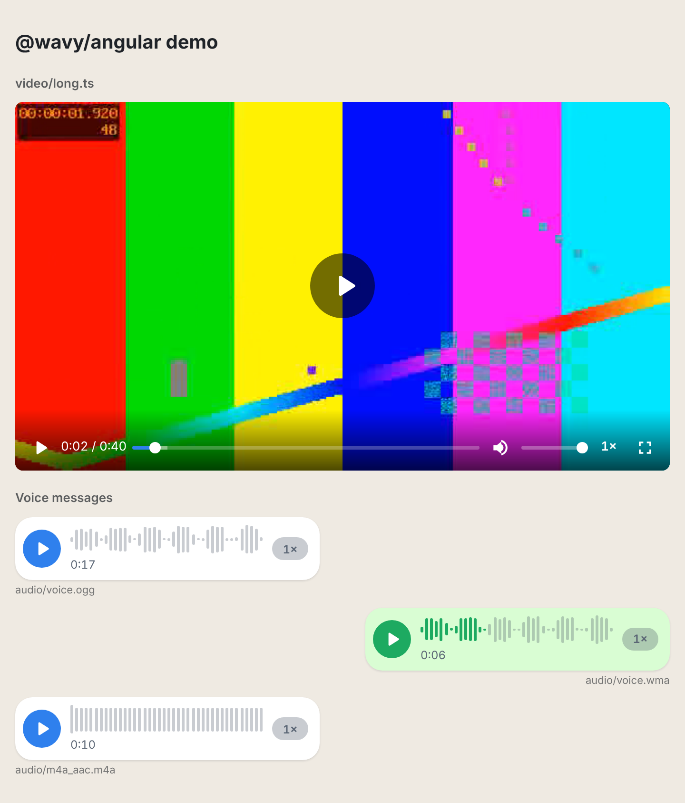

# @wavy/angular

Angular players for the wavy playback service:

- **`<wavy-video>`**: a video player for any file on the share (CCTV exports, camcorder
  footage, edit exports). It probes the file, starts a session, plays the original file or
  HLS, seeks past what FFmpeg has produced, and restarts a lost session at the same
  position.
- **`<wavy-audio>`**: a voice-message player in the style of WhatsApp and Telegram: a
  round play button, a waveform drawn from the real audio that fills as it plays, tap or
  drag to seek, elapsed and total time, and a 1x / 1.5x / 2x button.

Both are standalone components built on signals. One package, for **Angular 20, 21 and
22**.



- [Install](#install)
- [Set up the app](#set-up-the-app)
- [Access tokens](#access-tokens)
- [Cookies, CORS and the sticky session](#cookies-cors-and-the-sticky-session)
- [Video player](#video-player-wavy-video)
- [Voice-message player](#voice-message-player-wavy-audio)
- [Building your own player](#building-your-own-player)
- [Build and publish the package](#build-and-publish-the-package)
- [Develop](#develop)

## Install

```bash
npm install @wavy/angular hls.js
```

| Peer dependency | Versions |
| --- | --- |
| `@angular/core`, `@angular/common` | 20, 21 or 22 |
| `hls.js` | 1.5 or later. Loaded lazily, only when a file needs HLS. |

The package is built with Angular 20 in partial compilation mode, so the same build works
in 20, 21 and 22 apps; CI builds a 20, a 21 and a 22 app against it. It works with and
without Zone.js. The components don't touch the DOM during server-side rendering.

The playback service needs the `GET /api/peaks` endpoint (wavy-server 0.3) for the
waveforms. Against an older server the voice-message player still plays, with
placeholder bars.

## Set up the app

```ts
// app.config.ts
import { ApplicationConfig } from '@angular/core';
import { provideWavy } from '@wavy/angular';

export const appConfig: ApplicationConfig = {
  providers: [
    provideWavy({
      apiBase: 'https://media.example.com', // where wavy is; leave out when it's on the same origin
      withCredentials: true,                // see "Cookies, CORS and the sticky session"
      getToken: (path) => fetchPlaybackToken(path),
    }),
  ],
};
```

| Setting | Default | |
| --- | --- | --- |
| `apiBase` | the page's origin | URL of the playback service. |
| `getToken` | none | `(path) => string \| null \| Promise<…>`. The access token for a file. Leave it out when the service runs with `AUTH_MODE=none`. |
| `withCredentials` | `false` | Send cookies with every request: API calls, the media element and hls.js. |
| `autoResume` | `true` | When a session is lost, start a new one at the same position. |
| `maxResumes` | `3` | Resumes allowed per minute before the player gives up and shows an error. |
| `stopOnPageHide` | `true` | End the session (and its FFmpeg) when the tab closes, with `sendBeacon`. |
| `hlsConfig` | `{}` | Extra [hls.js settings](https://github.com/video-dev/hls.js/blob/master/docs/API.md#fine-tuning), merged over the player's. |
| `fetch` | global `fetch` | For tests, or to add headers. |

When `getToken` needs Angular services, pass a function. It runs in an injection context:

```ts
import { HttpClient } from '@angular/common/http';
import { inject } from '@angular/core';
import { firstValueFrom } from 'rxjs';
import { cacheTokens, provideWavy } from '@wavy/angular';

provideWavy(() => {
  const http = inject(HttpClient);
  return {
    apiBase: environment.wavyUrl,
    withCredentials: true,
    getToken: cacheTokens((path) =>
      firstValueFrom(http.post<{ token: string }>('/media/token', { path })).then((r) => r.token),
    ),
  };
});
```

`provideWavy` can also go in a route's or a lazy component's `providers` to use other
settings there.

## Access tokens

With `AUTH_MODE=jwt`, wavy plays a file only with a short-lived token signed by the
main server for that path. The server repo's
[docs/access-tokens.md](https://github.com/kobalt42z/wavy-server/blob/main/docs/access-tokens.md)
covers the keys and the token endpoint.

- `getToken(path)` is called before every request that names a file: the waveform
  (`GET /api/peaks`), the probe (`GET /api/probe`) and the session start
  (`POST /api/sessions`). The token goes out as `Authorization: Bearer <token>`.
- It is called again for each automatic resume, which can be long after the page loaded.
  Return a fresh token each time, not one captured at startup.
- Wrap it in `cacheTokens(getToken, { maxAgeSec: 240 })` so a page of voice messages
  doesn't ask the main server three times per file. Keep `maxAgeSec` well below the
  token's lifetime and wavy's `JWT_MAX_TOKEN_AGE_SEC` (900 s by default).
- Playback itself (the playlist, segments, the file, seeks, stop) uses the session URL,
  which needs no token. A token that expires mid-video doesn't stop it.
- If `getToken` throws, the player shows "You don't have access to this file." and starts
  nothing. A token for another file gets the service's 403 reason.
- A token whose `path` is a folder (`cases/12/`) covers every file under it, so one token
  can serve a whole conversation's voice messages: return the same one for each path.

## Cookies, CORS and the sticky session

Behind several pods, a session lives on one pod. The load balancer (Contour
`HTTPProxy` with cookie affinity) sets a cookie so that the playlist, the segments and
seeks reach that pod. The browser must send that cookie back:

- **Same origin** (the app and wavy behind one host, e.g. `/media-api/` proxied to wavy):
  cookies go along anyway. Leave `withCredentials` off.
- **Another origin** (`app.example.com` calling `media.example.com`): set
  `withCredentials: true`. The package then uses `credentials: 'include'` on its `fetch`
  calls, `crossorigin="use-credentials"` on the media element and `withCredentials` in
  hls.js. On the server, `CORS_ORIGINS` must list the app's origin exactly
  (`https://app.example.com`, no `*`), because browsers don't send cookies to a `*`
  origin.

If the cookie is lost anyway (blocked third-party cookies, a pod restart, a scale-down),
the next request reaches a pod that doesn't hold the session and gets a 404. The players
notice and start a new session at the same position: hls.js network errors, a file that
stops loading mid-playback, and seeks that get 404 are all handled. If the new pod is
busy (503) or still going away, they retry with a backoff (2, 4, 8, 8, 8 s). After
`maxResumes` losses within a minute they give up and show an error with a retry button.

## Video player: `<wavy-video>`

```ts
import { Component } from '@angular/core';
import { WavyVideoComponent, PlaybackError, describeError } from '@wavy/angular';

@Component({
  selector: 'app-evidence',
  imports: [WavyVideoComponent],
  template: `
    <wavy-video
      [path]="file.path"
      [start]="file.bookmark"
      (playbackError)="onError($event)"
      (resumed)="log('session restarted at', $event)"
    />
  `,
})
export class Evidence {
  file = { path: 'cctv/2026-10-01/cam3.dav', bookmark: 30 };
  onError(err: PlaybackError) {
    console.warn(err.code, describeError(err));
  }
  log(...args: unknown[]) {
    console.log(...args);
  }
}
```

Nothing is requested from the server except a probe (for the duration) until the user
presses play. Changing `path` stops the old session (and its FFmpeg) first.

The built-in controls show the file's real timeline: after a seek past what FFmpeg has
produced, the server restarts the stream at that point and HLS timestamps start at 0
again, but the time display and the seek bar stay in file time. The seek bar shows the
played part, the part that plays without a restart (lighter), and the rest. Browser
controls (`controls="native"`) don't know about that offset.

**Inputs**

| Input | Type | Default | |
| --- | --- | --- | --- |
| `path` | `string` | required | File path relative to the media root, or the `http(s)` URL a token grants. |
| `start` | `number` | `0` | Where to start, in seconds. |
| `audioTrack` | `number` | first | An `audio[].track` value from the probe. |
| `poster` | `string` | none | Image shown before playback. |
| `autoplay` | `boolean` | `false` | Start the session and play as soon as `path` is set. Browsers may refuse sound without a click. |
| `controls` | `'custom' \| 'native' \| 'none'` | `'custom'` | |
| `probeOnLoad` | `boolean` | `true` | Probe when `path` is set, to show the duration and report unplayable files early. |
| `exclusive` | `boolean` | `false` | Pause other Wavy players when this one starts. |
| `rates` | `number[]` | `[1, 1.25, 1.5, 2, 0.5]` | Speeds the speed button cycles through. |

**Outputs**: `playbackError` (`PlaybackError`), `probed` (`ProbeResponse`), `started`,
`ended`, `resumed` (position in seconds of a session restart).

**Methods** (with `#player="wavyVideo"` or `viewChild(WavyVideoComponent)`): `play()`,
`pause()`, `toggle()`, `seek(seconds)`, `toggleFullscreen()`, and the `ctl()` signal with
`position()`, `duration()`, `playing()`, `busy()`, `error()`.

**Keyboard** (when the player has focus): space or `k` play/pause, `←` / `→` 5 s,
`m` mute, `f` full screen.

**Styling**: the player fills its container's width at 16:9. CSS custom properties:

```css
wavy-video {
  --wavy-video-accent: #e53935;     /* played part of the seek bar */
  --wavy-video-aspect-ratio: 4 / 3;
  --wavy-video-radius: 0;
  --wavy-video-bg: #000;
  --wavy-video-fg: #fff;
  --wavy-video-font: inherit;
}
```

## Voice-message player: `<wavy-audio>`

```ts
import { Component, input } from '@angular/core';
import { WavyAudioComponent } from '@wavy/angular';

@Component({
  selector: 'app-message',
  imports: [WavyAudioComponent],
  template: `
    <div class="bubble" [class.mine]="mine()">
      <wavy-audio [path]="path()" />
    </div>
  `,
  styles: `
    .mine wavy-audio { --wavy-audio-bg: #d9fdd3; --wavy-audio-accent: #1daa61; }
  `,
})
export class Message {
  path = input.required<string>();
  mine = input(false);
}
```

How it behaves:

- On load it fetches the waveform (`GET /api/peaks?count=200`) and shows the length. The
  server decodes the audio once with FFmpeg and caches it, so this works for every format
  wavy plays: Opus, Ogg, MP3, AAC, M4A, WAV, WMA, G.711, and the audio of video files.
- The first press of play starts the session. Until then nothing runs on the server.
- Tapping or dragging on the waveform seeks, also before the first play (playback then
  starts there). Arrow keys seek 5 s; space and Enter play and pause.
- The time shows the length until playback starts, then the elapsed time, like chat apps.
- When it ends it goes back to the start.
- Only one voice message plays at a time: starting one pauses the other (`exclusive`).
- The number of bars follows the player's width.

**Inputs**

| Input | Type | Default | |
| --- | --- | --- | --- |
| `path` | `string` | required | File path relative to the media root, or the `http(s)` URL a token grants. |
| `audioTrack` | `number` | first | Which audio track to play and draw. |
| `peaks` | `number[] \| null` | `null` | Waveform values from 0 to 1, when the app has them already. Skips the server request. |
| `waveform` | `boolean` | `true` | Fetch the waveform from the server when `peaks` is not given. |
| `duration` | `number` | none | Length in seconds to show before anything has loaded. |
| `barWidth`, `barGap` | `number` | `3`, `2` | In px. |
| `exclusive` | `boolean` | `true` | Pause other Wavy players when this one starts. |
| `showSpeed` | `boolean` | `true` | Show the speed button. |
| `rates` | `number[]` | `[1, 1.5, 2]` | Speeds the speed button cycles through. |

**Outputs**: `playbackError` (`PlaybackError`), `started`, `paused`, `ended`.

**Methods** (with `#msg="wavyAudio"`): `play()`, `pause()`, `toggle()`, `seek(seconds)`,
`cycleRate()`.

**Styling**: light and dark defaults (following `prefers-color-scheme`), and CSS custom
properties to match your chat:

```css
wavy-audio {
  --wavy-audio-width: 320px;             /* the player is max-width: 100% */
  --wavy-audio-bg: #ffffff;              /* bubble */
  --wavy-audio-fg: #5b6675;              /* time and speed text */
  --wavy-audio-accent: #2f80ed;          /* play button */
  --wavy-audio-played: var(--wavy-audio-accent); /* bars already played */
  --wavy-audio-unplayed: rgba(60, 72, 88, 0.28); /* bars still to play */
  --wavy-audio-button-fg: #ffffff;
  --wavy-audio-wave-height: 30px;
  --wavy-audio-radius: 18px;
  --wavy-audio-shadow: none;
  --wavy-audio-error: #d93025;
  --wavy-audio-font: inherit;
}
```

**Waveforms from the app.** For audio that isn't on the share yet (a message the user just
recorded), compute the peaks in the browser and pass them in:

```ts
import { peaksFromAudioBuffer } from '@wavy/angular';

const buffer = await new AudioContext().decodeAudioData(await blob.arrayBuffer());
this.peaks.set(peaksFromAudioBuffer(buffer, 100));
// <wavy-audio [path]="path" [peaks]="peaks()" />
```

`WavyService.peaks(path, count)` fetches them from the server yourself, for example to
store them next to the message.

## Building your own player

Everything the components use is exported:

| Export | What it is |
| --- | --- |
| `WavyService` | `createPlayer(media)`, `probe(path)`, `peaks(path, count)` with the app's settings. |
| `WavyPlayer` | Framework-free client for one `<video>`/`<audio>`: `load(path, { start, audioTrack, autoplay })`, `seek(seconds)`, `stop()`, `destroy()`, `currentTime`, `duration`, `availableEnd`, events `statechange`, `session`, `resume`, `error`. The same logic as the server repo's `player/wavy-player.js`. |
| `MediaController` | A `WavyPlayer` as signals (`playing`, `busy`, `position`, `duration`, `availableEnd`, `error`, `message`) with a lazy `play()`, `seek()`, `toggle()`, volume and speed. |
| `WavyPlaybackFocus` | Lets one player play at a time. |
| `StreamSupportDirective` | `<video [streamSupport]="session">`: plays a session you started yourself. It doesn't call the API; its `streamLost` output gives the position when the session is lost, so you can start a new one. |
| `PlaybackError`, `describeError`, `formatTime` | Errors with the API's `code` and `reason`, one sentence for the user, `m:ss`. |
| `fitPeaks`, `peaksFromAudioBuffer` | Waveform helpers. |
| `HLS_LOADER` | Provide it to load hls.js your own way (a CDN build, a fake in tests). |

```ts
const media = viewChild.required<ElementRef<HTMLVideoElement>>('media');
private wavy = inject(WavyService);

afterNextRender(() => {
  const ctl = new MediaController(this.wavy.createPlayer(this.media().nativeElement));
  ctl.setSource('cctv/cam3.dav');
  this.ctl.set(ctl);
});
// template: {{ ctl()?.position() | number: '1.0-0' }} s, (click)="ctl()?.toggle()"
```

## Build and publish the package

The package isn't on a public registry; build it and publish it to your own one.

```bash
cd clients/angular
npm ci
npm test                  # unit tests (Vitest)
npm run build             # → dist/wavy, the publishable package
npm run pack              # → dist/wavy/wavy-angular-<version>.tgz, to install or upload by hand
```

The version is in `projects/wavy/package.json`. Bump it there before a release.

To publish to a private registry (Artifactory, Nexus, GitHub Packages, Verdaccio…), point
the scope at it and publish the built folder:

```bash
# ~/.npmrc or the CI job's .npmrc
@wavy:registry=https://registry.example.com/api/npm/npm-local/
//registry.example.com/api/npm/npm-local/:_authToken=${NPM_TOKEN}

cd dist/wavy && npm publish
```

Apps then install it with the same `@wavy:registry` line in their `.npmrc`. Some
registries need the scope to be yours (GitHub Packages wants `@<owner>/…`); rename
`name` in `projects/wavy/package.json` and the imports follow. You can also add a
`publishConfig` there:

```json
"publishConfig": { "registry": "https://registry.example.com/api/npm/npm-local/" }
```

Always publish from `dist/wavy`, never from `projects/wavy` (that's the TypeScript
source). Build with the committed toolchain (Angular 20) so the package keeps working on
20, 21 and 22.

## Develop

From `clients/angular`:

```bash
npm ci
npm test                         # Vitest + jsdom
npm run demo                     # demo app on http://localhost:4200
npm run check:packaged           # builds the package, then the demo app against dist/wavy
```

The demo reads its settings from the URL. With wavy running on port 8080 and
`CORS_ORIGINS=*` (or `http://localhost:4200`):

```
http://localhost:4200/?api=http://localhost:8080&video=cctv/raw_hevc.265&audio=audio/opus.opus,audio/wma.wma
```

Add `&token=<jwt>` for a server with `AUTH_MODE=jwt`, and `&credentials=1` to send cookies.

**Other Angular versions.** The committed workspace is on Angular 20. To run the tests and
builds on 21 or 22:

```bash
node scripts/use-angular.mjs 22   # rewrites package.json: Angular, TypeScript, Vitest
npm install
npm test && npm run check:packaged
git checkout package.json package-lock.json
```

CI does this for 20, 21 and 22 (`angular-compat` in `.github/workflows/ci.yml`), and also
builds an app on each version against the package built with 20.
